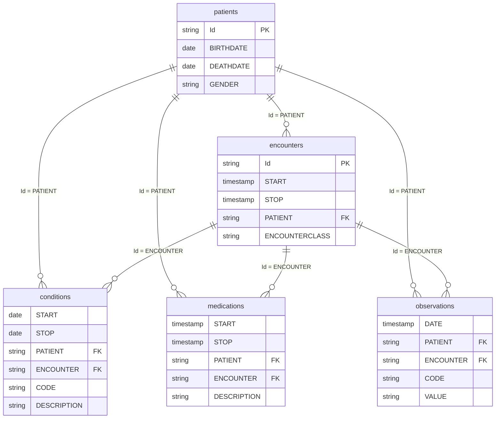

# Laboratorio 10 — Base clínica

## Datos

Los CSV se generan con Synthea. Comando:

```bash
java -jar synthea-with-dependencies.jar -s 42 -p 5000 --exporter.csv.export=true --exporter.fhir.export=false --exporter.csv.included_files=patients.csv,encounters.csv,conditions.csv,medications.csv,observations.csv --exporter.csv.excluded_files= Massachusetts
```

## Motor

Trabajo solo en mi computadora, así que no necesito un servidor al que se conecten otras personas. DuckDB guarda la base en un archivo, corre SQL y el script de carga se puede repetir. PostgreSQL se parecería más a OHDSI, pero esa semejanza no aporta mientras los datos viven en CSV y solo los consulta una persona.

## Diagrama

El dibujo completo está en [diagrama.md](diagrama.md). Lo repito aquí para verlo en esta misma página.


