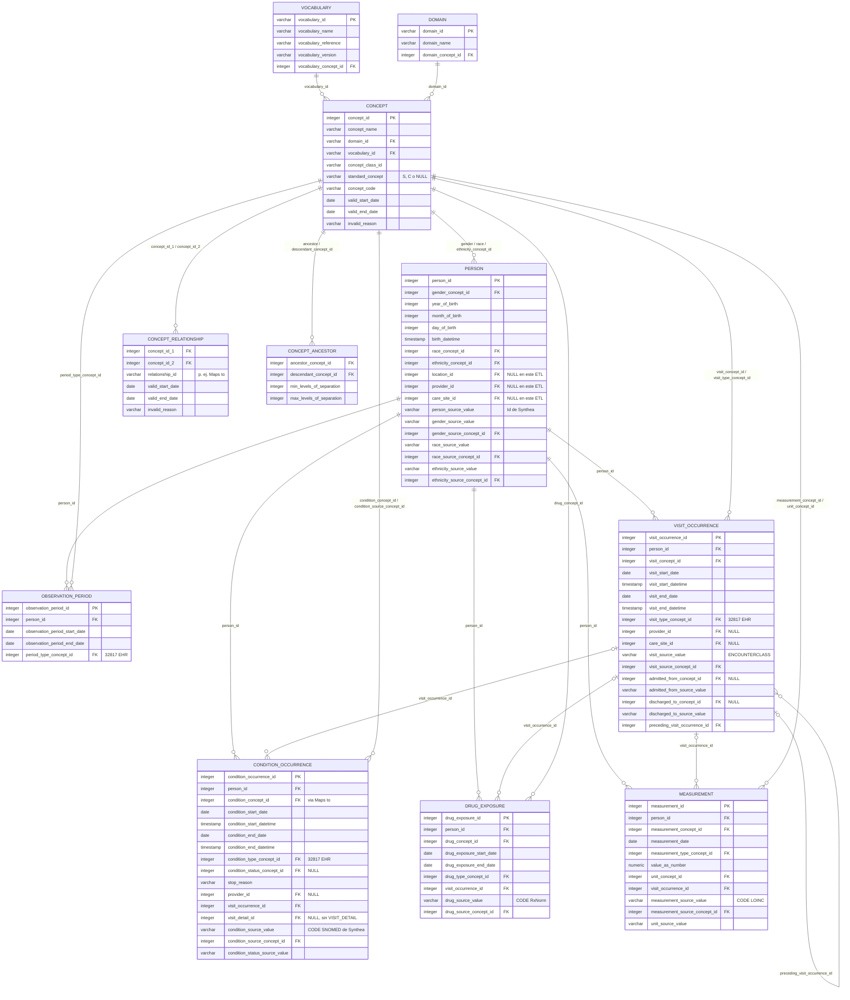

# Laboratorio 12 — Diagrama ER de las tablas cargadas en `omop.duckdb`

Tablas creadas por `sql/cargar_vocab.py` (vocabulario) y `sql/convertir.py`
(datos clínicos), con las columnas de la DDL oficial OMOP CDM v5.4.

- **PK** = clave primaria (en DuckDB solo declaramos las PK de las tablas clínicas).
- **FK** = clave foránea *lógica* (la DDL oficial las crea en un script aparte;
  aquí **no** se imponen como restricción, solo se documentan).
- Todas las columnas `*_concept_id` son FK a `CONCEPT.concept_id`. Para no
  saturar el dibujo, solo se dibujan algunas de esas líneas.
- `DRUG_EXPOSURE` y `MEASUREMENT` son opcionales (se muestran solo sus columnas principales).

## Diferencias entre nuestro ETL "a mano" y la especificación oficial v5.4

Las **columnas y tipos** de las tablas son los de la DDL oficial v5.4 (lo
comprobamos columna a columna). Lo que cambia es **cómo se rellenan** y
**qué tablas faltan**:

| # | Diferencia | ¿Simplificación legítima? |
|---|------------|---------------------------|
| 1 | **`provider_id`, `care_site_id` y `location_id` quedan en NULL** y no existen las tablas `PROVIDER`, `CARE_SITE` ni `LOCATION` (Synthea sí tiene esa información en `providers.csv` / `organizations.csv`, pero no los exportamos). | **Sí.** En v5.4 esas columnas admiten NULL. Se pierde información (no podríamos analizar por proveedor u hospital), pero el modelo sigue siendo válido. |
| 2 | **`observation_period` se deduce de los encuentros**: un único periodo por persona, de la primera a la última visita. No hay datos de afiliación/seguro. | **Sí, es práctica habitual en datos EHR** (el ETL oficial ETL-Synthea hace lo mismo). Pero tiene efectos: por zona horaria (Synthea escribe la fecha de la condición en hora local y la del encuentro en UTC), algunas condiciones quedan 1 día *antes* del inicio del periodo (actividad 8). |
| 3 | **No hay enrutado por dominio**: todo `conditions.csv` va a `condition_occurrence`, aunque el concepto estándar sea del dominio *Observation* (empleo, estrés, educación... ver consulta 5.3). | **No del todo.** Las convenciones OMOP dicen que cada registro va a la tabla de su dominio (estos deberían ir a `OBSERVATION`). Aceptable para un primer lab, pero hay que saberlo. |
| 4 | **Sin `VISIT_DETAIL`** y 1 encuentro = 1 visita (el ETL oficial fusiona encuentros hospitalarios consecutivos y descarta las clases virtual/home/hospice/snf; nosotros las dejamos con `visit_concept_id = 0`). | **Sí.** `VISIT_DETAIL` es opcional; las visitas sin mapeo con 0 cumplen la convención. |
| 5 | **Un solo Type Concept (32817 EHR)** para visitas, condiciones y periodos (el ETL oficial usa conceptos más específicos). | **Sí.** 32817 es un concepto estándar válido del vocabulario *Type Concept*. |
| 6 | Faltan otras tablas: `DEATH` (aunque Synthea tiene `DEATHDATE`), `CDM_SOURCE`, `OBSERVATION`, `PROCEDURE_OCCURRENCE`, las tablas *era* (`CONDITION_ERA`, `DRUG_ERA`). Tampoco hay restricciones FK en DuckDB. | **Sí para el lab**, pero herramientas como Achilles o Data Quality Dashboard esperan `CDM_SOURCE` y las tablas *era*. |
