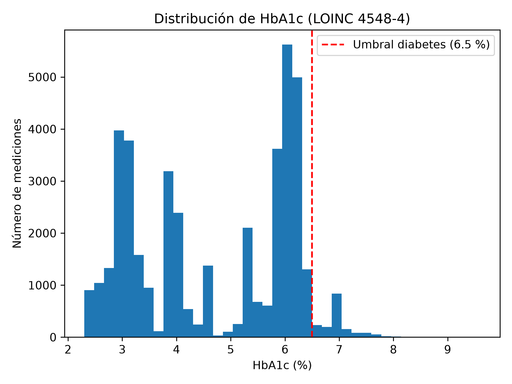

# Actividad 7 – Auditoría de unidades (HbA1c, LOINC 4548-4)

| Unidad | Mediciones | Mínimo | Máximo | Promedio |
|---|---|---|---|---|
| % | 42,422 | 2.3 | 9.6 | 4.70 |

**Hallazgo:** el 100 % de las mediciones están en una sola unidad (%), por lo que no fue necesario convertir unidades (por ejemplo, de mmol/mol a %).

**Valores atípicos:** Se observan datos en el valor de 2.3 % lo cual es muy poco visto en una persona convencional

**Forma de la distribución:** en una distribución de la vida real se observaria una distribución con aproximación a una distribución normal, sin embargo, aqui se observan picos en números especificos en el rango observado, lo cual hace pensar que Synthea genera los datos creando subgrupos.

