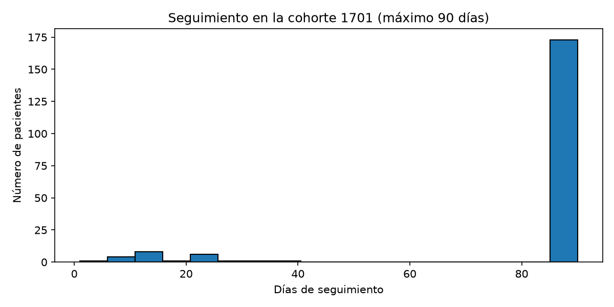

# Caracterización – Cohorte 1701 (tabla 1)

| Característica | Valor |
|---|---|
| N | 196 |
| Edad en la fecha índice, mediana (RIC) | 71 (67–76) años |
| Edad en la fecha índice, media | 72.7 años |
| Hombres, n (%) | 99 (50.5 %) |
| Mujeres, n (%) | 97 (49.5 %) |
| Seguimiento, mediana (rango) | 90 (1–90) días |
| Censurados antes de 90 días | 23 (11.7 %) |

## 10 comorbilidades más frecuentes en el año previo, con solo trastornos por SNOMED)

| Comorbilidad | n | % |
|---|---|---|
| Gingivitis | 91 | 46.4 |
| Cardiopatía isquémica | 61 | 31.1 |
| Enfermedad gingival | 42 | 21.4 |
| Infarto de miocardio | 42 | 21.4 |
| Caries dental primaria | 27 | 13.8 |
| Infarto agudo de miocardio sin elevación del ST | 23 | 11.7 |
| Infarto agudo de miocardio con elevación del ST | 17 | 8.7 |
| Sinusitis viral | 15 | 7.7 |
| COVID-19 | 14 | 7.1 |
| Hipoxemia | 13 | 6.6 |

**Nota:** sin filtrar, la condición más frecuente era "No matching concept" (concept_id 0, 63.8 %), seguida de hallazgos sociales y administrativos (empleo, estrés, revisión de medicamentos). Se filtró a `concept_class_id = 'Disorder'` y se excluyó el concept_id 0. .

## Histograma de seguimiento

La mayoría completa los 90 días. Los 23 aliminados antes tienen un periodo de observación que termina con la simulación (24 de septiembre de 2026).
