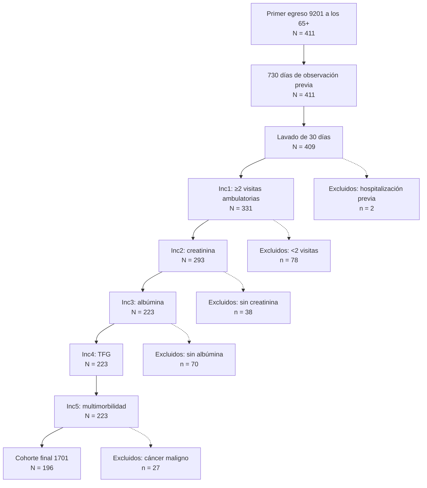
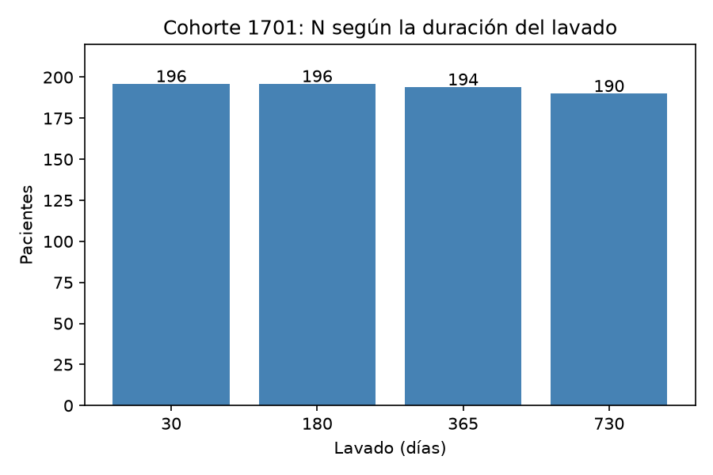

# Diagnóstico de la cohorte 1701 (Laboratorio 18)

Cohorte auditada: primer egreso hospitalario (visita 9201) a los 65 años o más,
definida en el Laboratorio 17 y guardada en `results.cohort` con `cohort_definition_id = 1701`.

## 1. Factibilidad

Consulta: `tu-entrega/factibilidad.sql`

| Medida | Valor |
|---|---|
| Pacientes en la cohorte | 196 |
| Seguimiento en días (P25 / mediana / P75) | 90 / 90 / 90 |
| Pacientes con reingreso (9201) | 37 |
| Pacientes con urgencias (9203) | 26 |
| Pacientes con desenlace compuesto | 57 (29.1 %) |

**Veredicto:** Tomando en consideración que para un modelo se solicitan por lo menos 10 eventos por variable, tendria que usar como máximo 5 a 6 variables en mi modelo (desenlace compuesto 57), por lo cual es muy complicado realizar los bloques M0 y M3 que he propuesto en mi modelo. 

**Limitación:** la base no tiene tabla `death`, así que la mortalidad no está incluida
en el desenlace y con ello se asume que mi limite inferior es 57, a partir de ello se puede incrementar el número de eventos.  

## 2. Atrición

Fuente: `s17-cohortes-omop-sql/tu-entrega/atricion.md` (misma cohorte 1701).

| Paso | N | % del inicial | Pérdida |
|---|---|---|---|
| Evento inicial: primer egreso 9201 a los 65+ | 411 | 100.0 % | — |
| 730 días de observación previa | 411 | 100.0 % | 0 |
| Lavado de 30 días sin hospitalización | 409 | 99.5 % | 2 |
| Inc1: 2 o más visitas ambulatorias en 365 días | 331 | 80.5 % | 78 |
| Inc2: creatinina en 365 días | 293 | 71.3 % | 38 |
| Inc3: albúmina en 365 días | 223 | 54.3 % | 70 |
| Inc4: TFG en 365 días | 223 | 54.3 % | 0 |
| Inc5: 2 o más enfermedades crónicas en 730 días | 223 | 54.3 % | 0 |
| Exc2: cáncer maligno en 365 días | 196 | 47.7 % | 27 |

Los criterios que más pacientes quitan son 2 o más visitas ambulatorias en 365 días y albúmina en 365 días.

## 3. Sensibilidad al orden de los criterios

Consulta: `tu-entrega/orden_alternativo.sql` (se intercambiaron Inc1 visitas ambulatorias e Inc3 albúmina).

| Paso | Orden original (N) | Orden alternativo (N) |
|---|---|---|
| Lavado | 409 | 409 |
| Primer criterio | 331 (visitas) | 227 (albúmina) |
| Creatinina | 293 | 227 |
| Tercer criterio | 223 (albúmina) | 223 (visitas) |
| TFG | 223 | 223 |
| Multimorbilidad | 223 | 223 |
| Final sin cáncer | 196 | 196 |

**Conclusión:** Al cambiar el orden de los criterios de inclusión la N final no cambia (196), sin embargo la albúmina parece un criterio mas duro porque se lleva todos los que no cumplirían varios criterios a la vez. Es por ello que la pérdida de cada paso depende del orden y no mide la importancia de un criterio por sí solo. 

## 4. Diagrama de flujo (tipo CONSORT)

## 5. Incidencia por año calendario y grupo de edad

Consulta: `tu-entrega/incidencia.sql`

| Grupo de edad | Pacientes | % |
|---|---|---|
| 65-69 | 73 | 37.2 |
| 70-74 | 57 | 29.1 |
| 75-79 | 40 | 20.4 |
| 80-84 | 12 | 6.1 |
| 85 o más | 14 | 7.1 |

**Por año:** entre 1983 y 2013 hay de 1 a 4 entradas por año.Desde 2014 aumentan,
con un máximo de 21 en 2020, 2026 está incompleto (debido a que la base termina el 24 de septiembre de 2026).

**Interpretación (lo que dice de los datos):**El mayor número de entradas en años recientes se explica porque Synthea simula la vida completa de cada persona. Como 2026 no ha terminado y la base se corta en septiembre, por eso tiene 9 registros. Hay mas registros en el grupo de 65 a 69 años porque la cohorte toma el primer egreso después de los 65 años y la mayoria lo tiene poco después de cumplir esa edad. 

## 6. Códigos de entrada (diagnósticos de la hospitalización índice)

Consulta: `tu-entrega/codigos_entrada.sql`. El evento de entrada es la visita 9201, así que
se desglosan los diagnósticos registrados en esa misma visita (`visit_occurrence_id`).

| Diagnóstico | Pacientes | % |
|---|---|---|
| No matching concept (0) | 84 | 42.9 |
| Hypoxemia | 13 | 6.6 |
| Pneumonia | 13 | 6.6 |
| Respiratory distress | 13 | 6.6 |
| Acute pulmonary embolism | 7 | 3.6 |
| Sepsis caused by virus | 6 | 3.1 |
| Acute respiratory failure | 5 | 2.6 |
| Acute deep venous thrombosis | 3 | 1.5 |
| Acute infective cystitis | 1 | 0.5 |
| Suspected COVID-19 | 1 | 0.5 |

**Interpretación:** 
El 42.9 % (84 pacientes) tiene "No matching concept". Por lo cual se asume que no se mapearon a un concepto estándar. 

Los diagnósticos que sí se mapearon son casi todos agudos respiratorios o trombóticos: hipoxemia, neumonía y dificultad respiratoria, embolia pulmonar, sepsis viral, insuficiencia respiratoria, trombosis venosa y COVID-19.  No aparecen causas típicas de hospitalización agudad en adultos mayores algunas de ellas, como: insuficiencia cardiaca, fractura de cadera,exacerbación de  EPOC o infección urinaria complicada.

En total hay muy pocos diagnósticos distintos ligados a la visita índice.

Para el proyecto final esto implica que la cohorte está cargada hacia hospitalizaciones respiratorias agudas, sobre todo COVID-19, y no representa bien las causas típicas de hospitalización en adultos mayores. 

## 7. Conceptos huérfanos

Consulta: `tu-entrega/huerfanos.sql`

La entrada usa solo `visit_concept_id = 9201`. En la base no existen otros conceptos de
hospitalización (262, 32037), pero hay 4,298 visitas con `visit_concept_id = 0`
(No matching concept) de 1,675 pacientes.

| Tipo de visita | Visitas | Duran ≥1 día | % | Mediana de días |
|---|---|---|---|---|
| 9201 Inpatient | 5,207 | 5,207 | 100.0 | 3 |
| 0 Sin mapear | 4,298 | 1,653 | 38.5 | 0 |
| 9202 Outpatient | 288,109 | 15,800 | 5.5 | 0 |

**Candidato a huérfano:** las visitas 0 que duran 1 día o más (1,653).

**Decisión:** no se agregan a la definición principal, porque sin un tipo de visita conocido no hay forma fidedigna de distinguir una hospitalización de una consulta u observación prolongada, y agregarlas metería falsos positivos. Efecto: la cohorte puede estar
subestimando los egresos índice y también los reingresos (el desenlace), de modo que los 57 eventos son un mínimo. 

## 8. Reconstrucción en ATLAS (demo público) y casos borde de CIRCE

Se reconstruyó la cohorte en el demo público de ATLAS (Cohort #1798498): evento de
entrada Visit 9201, primera vez, edad ≥65, 730 días de observación previa; criterios
de lavado de 30 días, albúmina y sin cáncer (443392 con descendientes); salida a 90 días
desde la fecha de fin. SQL exportado: `tu-entrega/atlas_cohorte.sql`.

*Limitación del demo:* el servidor no permitió guardar los últimos cambios (error al
guardar, incluso con las etiquetas obligatorias), por lo que el SQL exportado incluye solo
el lavado y la albúmina, y la salida quedó al fin de observación, falto el criterio de exclusión de cáncer maligno.

*Casos borde encontrados al comparar con `cohorte_definicion.sql`:*

1. *Orden entre "primera vez" y edad:** CIRCE numera todas las hospitalizaciones de la
   vida y pide que la primera sea a los 65+; mi SQL toma la primera a partir de los 65.
   Quien se hospitalizó antes de los 65 entra en mi cohorte, pero no en la de ATLAS.
2. *Fecha índice:* CIRCE usa `visit_start_date` (ingreso); yo uso el egreso. Cambian
   la edad, la observación previa y todas las ventanas de 365 días.
3. *Lavado y fechas de fin:* CIRCE compara el inicio de la otra hospitalización; yo
   comparo su fin. Además CIRCE asigna a cada medición una fecha de fin de +1 día.

*Otro detalle:* CIRCE siempre restringe los criterios al periodo de observación; en
Synthea no cambia nada porque hay un solo periodo por persona.

## 9. Sensibilidad al lavado (180, 365 y 730 días)

Script: `tu-entrega/variantes_lavado.py` (reutiliza `cohorte_definicion.sql` y solo cambia los días del lavado).

| Lavado (días) | N | Edad mediana | % hombres | Seguimiento mediano (días) |
|---|---|---|---|---|
| 30 (principal) | 196 | 71 | 50.5 | 90 |
| 180 | 196 | 71 | 50.5 | 90 |
| 365 | 194 | 71 | 50.5 | 90 |
| 730 | 190 | 71 | 50.5 | 90 |

*Interpretación:* El número total de individuos cambia poco porque el evento de entrada es el primer egreso a los 65 años o más, una hospitalización antes de los 65 años es algo que es poco frecuente que sea generado por Synthea (hospitalización). Como el lavado tiene poco que quitar la cohorte es robusta ante esta decisión.

## 10. Traslape entre variantes

Script: `tu-entrega/traslape_variantes.py` · Figura: `tu-entrega/traslape_variantes.png`

| Pacientes en común | 30 | 180 | 365 | 730 |
|---|---|---|---|---|
| **30** | 196 | 196 | 194 | 190 |
| **180** | 196 | 196 | 194 | 190 |
| **365** | 194 | 194 | 194 | 190 |
| **730** | 190 | 190 | 190 | 190 |

*Anidamiento:* 180 ⊂ 30, 365 ⊂ 180 y 730 ⊂ 365, sin pacientes fuera en ningún caso.

**Interpretación:** El lavado solo quita pacientes al estar anidadas las cohortes con cambios al solo agregar criterios más estrictos,  ya que al realizar intersecciones entre cada una de ellas quedan 0 individuos fuera. 

## 11. Discusión

**Decisión más influyente:** La decisión más influyente fue el modificar criterios de inclusión, ya que las visitas ambulatorias y la albúmina quitan 78 y 70 pacientes. Las demás posibilidades generaron los siguientes cambios: 
- El lavado, de 30 a 730 días, solo quitó 6 pacientes (3.1 %).
- El orden de los criterios no cambió el N final.
- En ATLAS  usar el ingreso o el egreso como fecha índice, y tomar "la primera hospitalización de la vida" o "la primera a partir de los 65" pueden modificar el número de individuos.

**Definición principal declarada:** 
Se mantiene la cohorte 1701: primer egreso hospitalario (9201) a partir de los 65 años, con fecha índice en el egreso y lavado de 30 días. El lavado se mantiene en 30 días porque las variantes de 180, 365 y 730 días están anidadas, quitan
como máximo 6 pacientes (3.1 %) y no cambian la edad, el sexo ni el seguimiento; alargarlo solo reduciría la muestra. La fecha índice se mantiene en el egreso (a diferencia del ingreso que ATLAS usa por defecto) porque el desenlace ocurre después del alta: contar desde
el ingreso metería días de hospitalización como tiempo inmortal y dejaría fuera los laboratorios tomados durante la estancia.

**Limitación propia:** 
Con 196 pacientes solo hay 57 eventos (37 reingresos y 26 urgencias), sin incluir la mortalidad porque la base no tiene tabla `death`. Con la regla de ~10 eventos
por variable, alcanza para un modelo de 5 o 6 variables, menos de las que plantea el proyecto final. Además, el 42.9 % de los diagnósticos de la hospitalización índice no está mapeado, y
1,653 visitas sin tipo (concepto 0) podrían ser hospitalizaciones no capturadas, lo que subestimaría tanto los egresos índice como los reingresos.

**Siguiente paso:** cargar la mortalidad desde `patients.csv` de Synthea y decidir con el profesor entre seguir con la base actual (196 pacientes) o generar una base Synthea más grande de personas de 65 años o más y aumentar el número de muestra decenas de miles para tener más datos con que trabajar. 

