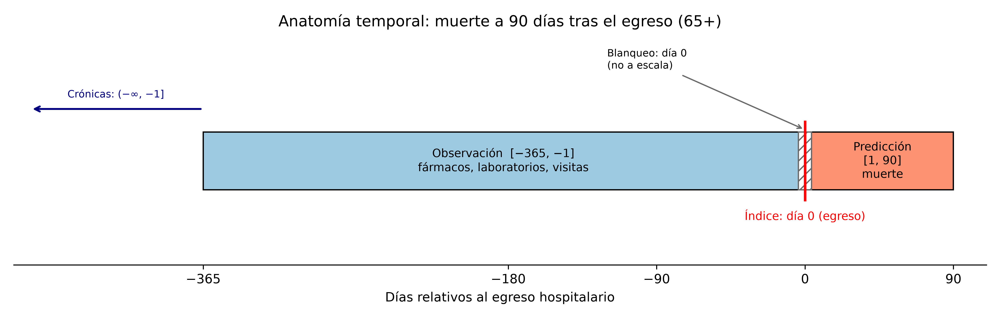

# Anatomía temporal del problema

| Elemento | Días | Justificación |
|---|---|---|
| Índice | 0 | El día del egreso hospitalario: es el momento en que se usaría el modelo para decidir el seguimiento. |
| Ventana de predicción | [1, 90] | El desenlace del proyecto es la muerte por cualquier causa en los 90 días posteriores al egreso. Se excluye el día 0 porque una muerte ese día no es predecible al alta, y quien murió el día del egreso o antes queda fuera de la cohorte. |
| Blanqueo | día 0 (1 día) | como OMOP guarda fechas sin hora, un registro fechado el día del egreso pudo capturarse después de la decisión de egrreso. |
| Ventana de observación | [−365, −1] | Un año previo para fármacos, laboratorios y visitas.Las enfermedades crónicas usan todo el historial previo, (−∞, −1], porquq cada diagnóstico crónico se registra una  sola vez. |
